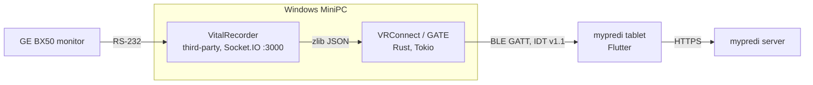

# VRConnect (GATE)

**VRConnect** (codename **GATE**) is the Rust middleware of the **Alison++** project. It runs on a
Windows MiniPC at the patient's bedside in the ICU. It receives vital signs from the monitor through
VitalRecorder and streams them over **Bluetooth Low Energy (IDT v1.1 protocol)** to the **mypredi**
tablet, which relays them to the mypredi server.

!!! note "Scope of this site"
    This is the **developer documentation** of the `vrconnect` repository: build, architecture,
    configuration and BLE protocol. Operational documentation (hospital procedures, soak test
    reports, architecture decisions, issue register) lives in the Alison documentation repository.

VRConnect is **pure IT middleware**: it makes no clinical decisions and drives no actuators.

## End-to-end chain



Internal pipeline:

```
Socket.IO → zlib decompression → JSON cleaning → transformation
                                                   ├── Console
                                                   ├── BLE (IDT v1.1, reliable ARQ)
                                                   └── File (JSON/CSV, daily rotation + zip archive)
```

## Code layout

| Module | Role |
|---|---|
| `src/config/` | Configuration: CLI (clap) + `.env` file (`--config-file`) |
| `src/input/` | Socket.IO server + zlib decompressor |
| `src/processor/` | JSON cleaning, `VitalData → ProcessedData` transformation |
| `src/core/processor.rs` | Tokio orchestrator (mpsc channels) |
| `src/domain/ble_protocol.rs` | IDT types and frames (DATA_FRAME, ACK, SUBSCRIBE…) |
| `src/output/ble_gatt.rs` | Native Windows GATT server (`windows` crate) |
| `src/output/ble_reliable.rs` | Reliable BLE output: sessions, ACK/retransmission, grace period, supervision, health |
| `src/output/ble_session.rs` | Session state, ARQ sliding window, history ring buffer |
| `src/output/wal.rs` | Append-only WAL (history durability) |
| `src/output/health.rs` | MiniPC health payload |
| `src/output/file.rs` | File recording + rotation/archiving |
| `src/utils/chaos.rs` | Chaos Monkey (testing only, see [Build & test](build.md#chaos-monkey)) |

!!! warning
    `src/output/ble.rs` is **legacy / dead code** (pre-IDT protocol, never instantiated). Do not reuse it.
